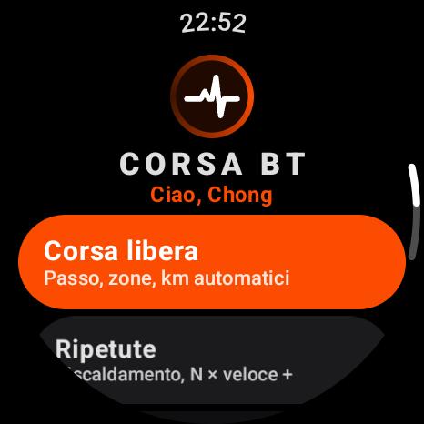
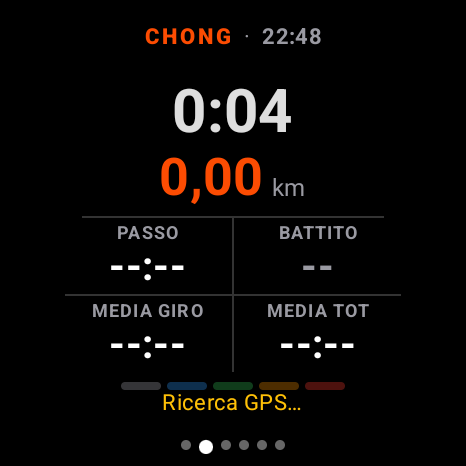
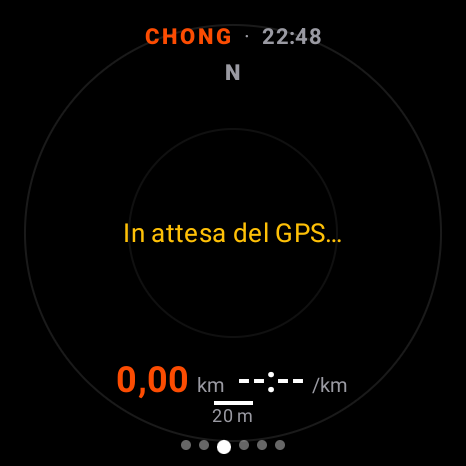
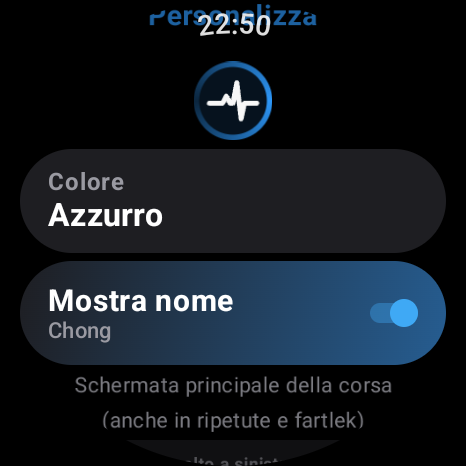

# Corsa BT: a running computer for the Xiaomi Watch 2 + Strava on iPhone

A Wear OS app. On the watch you see pace, heart rate, zones, intervals and fartlek;
at the same time the watch acts as a **Bluetooth heart rate sensor** for the Strava
app on your iPhone, which records GPS and route.

The app is bilingual, English and Italian, and follows the watch's system language
(you can also pick a per-app language in Android settings, Wear OS 4+ / Android 13+).

<p align="center">
  
  
  
  
</p>

## Quick install (no build required)

1. Download `corsa-bt.apk` from the latest [Release](../../releases/latest).
2. Enable wireless debugging on the watch and connect with `adb` (see *Build and install* below).
3. `adb install -r corsa-bt.apk`

## Features

| Mode | What it does |
|---|---|
| **Free run** | Time, distance, current/average pace, heart rate with a colored zone. Optional pace target (± tolerance) or heart rate zone target: the value is colored when you are off target, with no vibration. Automatic lap every km with a summary (pace, time, average ♥). |
| **Race** | 5K, 10K, half marathon, marathon or a custom distance. Set a goal finish time or average pace (each updates the other), or no goal. The main race screen shows elapsed time and ahead/behind vs goal (after 200 m) on top, plus 4 customizable fields (default: Pace, Km left, Finish ETA, Needed pace). A ring around the screen shows distance progress. Km splits every km (the lap banner also shows ahead/behind). Auto-pause is disabled in races. At the finish line a "FINISH!" banner and vibration show your final time and the delta to your goal. The finish is detected from the watch's GPS distance, which typically reads 0.5-2% long, so FINISH! may trigger slightly before the real line: keep running until you cross it and press **End**. |
| **Intervals** | Warm-up (minutes or "until LAP") → N × fast (distance or time) with a target pace/zone → recovery (time or distance) → cool-down. Progress ring, countdown, "virtual partner" (seconds ahead/behind the target pace), preview of the next step. |
| **Fartlek** | Timed (N fast/slow cycles) or free: press LAP at every change of pace. |
| **Ski** | Runs are detected automatically: a run starts when you are going faster than 10 km/h and are 15 m below the highest point since the last run; it ends at its lowest point once you climb 20 m (a lift) or after 3 minutes standing still. Chairlifts and other ascending lifts don't count (a descending gondola may be counted as a run); drops under 30 m are ignored. Runs are automatic: the LAP button and the physical stem key do nothing in Ski. Main screen: speed (km/h), max speed, altitude, runs, total descent, heart rate. At the end of each run a banner (run number, vertical drop, max speed) with one vibration. No auto pause, no km laps; each run is saved as a lap. |
| **Climbing** | Indoor (gym, no GPS) or outdoor (GPS + altitude). Press LAP or the physical button at the start and end of each route: the big label switches between ON ROUTE and REST with its own timer. Each route is saved with time, average heart rate (the Last route page also shows max) and (outdoor) ascent; rests are tracked but are not laps. Summary: routes, time on routes vs resting, longest climb. |
| **Hiking** | Time, distance, altitude, ascent/descent, vertical speed (m/h) and heart rate. Optional GPX route with map and off-route alert (as in Free run); auto pause and km laps follow your settings. Summary with ascent/descent and max altitude. |
| **HR sensor only** | Heart rate only to Strava, no GPS. |
| **History** | Summary of every workout: time in zone, laps/intervals with pace and heart rate. |

**Barometric altitude:** in every mode the watch's barometer gives altitude, total ascent and descent
(changes under 3 m are ignored as noise); vertical speed over the last minute is shown in Hiking only. In GPS modes on
Android 14+ the absolute altitude is calibrated to sea level from the first good GPS fixes; otherwise it
uses the standard atmosphere and can be off by tens of metres with the weather (ascent/descent are not
affected). Run summaries show ascent/descent too.

The watch stays a Bluetooth heart rate sensor for Strava in every mode.

**Vibration alerts:** slow down / speed up and HR high / HR low alerts work only in Intervals and timed Fartlek. In Free run and Race there are no pace or HR alerts: the vibrations are km splits, auto pause/resume, the finish line and off-route.

During a workout, swipe horizontally between pages:
**Controls** (Pause / Lap or Next step / End) ← **Main** → Route → Lap → Heart rate zone → Totals (cadence, GPS and iPhone status).
At the top of every page: your name and the time.
The **lower physical button** does LAP, if the watch allows it (except in Ski).

- **Main**: time, km, 4 customizable fields (default: current pace, heart rate,
  lap average, overall average) and the heart rate zone bar. The layout is designed
  to make better use of the round screen, with larger time, distance and values.
- **Route**: GPS track drawn live, north up, automatic zoom and scale.
  There is no street map underneath (the watch has no connection during the run).
- **Lap**: in Ski and Climbing it is the **Last run** / **Last route** page (descent, max speed, time, heart rate).
- **Totals**: in Ski, Climbing and Hiking it shows ascent and descent instead of pace and cadence. In Ski the Controls page has no Lap button.

**Customize** (from the menu): app color, name on/off, choice of the 4 fields on the main page ("Main run screen"), plus a separate set of 4 slots for the race screen ("Main race screen").

Settings: **Max HR** (Garmin zones 50/60/70/80/90 %), **Auto lap 1 km**, **Auto pause**,
**HR to iPhone**, **Screen on**, **Vibration**.

## Routes (GPX)

Free run, Race and Hiking can follow a course loaded from a GPX file (no connection needed during the run).

1. Get a GPX: e.g. on Strava open a route → **Export GPX** (any GPX with a track or route works).
2. Copy it to the watch (the folder is created the first time the app opens):
   ```
   adb push my-route.gpx /sdcard/Android/data/dev.watchstrava/files/routes/
   ```
   A test file is in `docs/sample-route.gpx` (a ~2 km loop in Milan).
3. In **Free run**, **Race** or **Hiking** setup, tap **Route** to pick it (the name comes from the GPX `<name>`, or the file name).
   Race shows the route length but does not change the race distance.

On the **Route** page the course is drawn in grey under your track, with start (green) and
finish (white ring) markers, zoomed to fit both, plus the km left on the course.
If you are more than 40 m from the course for 3 GPS fixes, an **OFF ROUTE** banner shows the
distance with one short vibration and the km left turn yellow; under 25 m a **BACK ON ROUTE**
banner appears (no vibration).

## Using it with Strava (iPhone)

1. Watch: choose the workout → **START** (grant permissions the first time).
2. iPhone: Strava → **Record** → sensors panel → **Add a sensor** → the watch.
   You only need to do this the first time; after that Strava reconnects on its own.
3. Start the activity on Strava. At the end of the run: **End** on the watch and save on Strava.

From the sensor Strava takes **heart rate only**; route, distance and pace are recorded by the iPhone.
Metrics on the watch use the watch's GPS, so they may differ slightly from Strava.

## Build and install

Tools already installed: JDK 17 (Temurin) and the Android SDK in `%LOCALAPPDATA%\Android\Sdk`.

```
gradlew.bat testDebugUnitTest   # tests for the workout logic
gradlew.bat assembleDebug       # → app\build\outputs\apk\debug\app-debug.apk
```

On the watch (once): *Settings → System → About* → tap **Build number** 7 times;
then *Developer options* → **ADB debugging** + **Wireless debugging** → **Pair new device**.
Watch and PC on the same Wi-Fi network (the iPhone hotspot works):

```
adb pair IP:PAIRING_PORT CODE
adb connect IP:WIRELESS_DEBUG_PORT
adb install -r app\build\outputs\apk\debug\app-debug.apk
```

## Troubleshooting

- *The iPhone can't see the watch*: iOS Settings → Privacy → Bluetooth → Strava enabled;
  the Totals page should show "waiting for iPhone".
- *"Bluetooth sensor not supported"*: the chip can't advertise as a peripheral;
  metrics on the watch still work.
- *Heart rate "--"*: tighten the strap; the value arrives after a few seconds.
